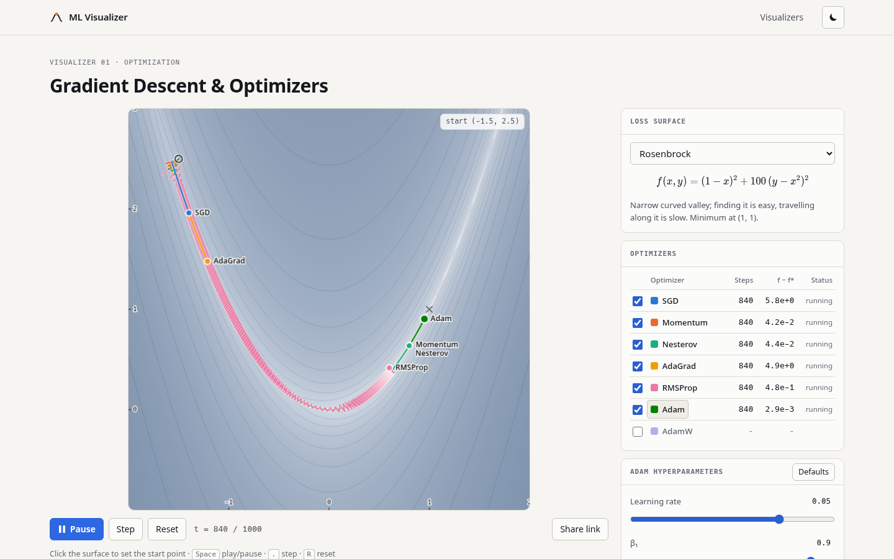

# ML Visualizer

Interactive, in-browser visualizations of machine learning algorithms. Everything is computed
client-side. There is no backend, no cookies and no tracking.



## Visualizers

| Visualizer                        | Status      |
| --------------------------------- | ----------- |
| **Gradient Descent & Optimizers** | Live        |
| **Decision Boundaries**           | Live        |
| Attention                         | Coming soon |
| Explainability (XAI) methods      | Coming soon |

### Gradient Descent & Optimizers

- **Surfaces:** ill-conditioned quadratic (κ = 25), Rosenbrock, Himmelblau, Beale, saddle
  `x² − y²`, and a stochastic-gradient quadratic. All use analytic gradients, and every surface
  supports additive Gaussian gradient noise from a seeded PRNG.
- **Optimizers:** SGD, Momentum (heavy ball), Nesterov (look-ahead form), AdaGrad, RMSProp, Adam,
  AdamW. Each has its own hyperparameters (η on a log slider, β / β₁ / β₂, ε, λ).
- **Race mode:** click (or use arrow keys and Enter) to set the start point, then run any subset of
  optimizers at once. A run stops automatically when it converges, diverges or leaves the domain.
- **Plots:** a log-scaled heatmap with isolines, a loss gap `f − f*` vs. iteration chart (log or
  linear y), and each optimizer's update rule in KaTeX with notes on when it works and when it fails.
- **Shareable state:** the full setup is encoded in a readable URL, e.g.
  `?s=beale&p=0.7,1.4&o=adam:lr=0.05,sgd:lr=0.001&n=1000`.

### Decision Boundaries

- **Datasets:** Gaussian blobs, XOR, two moons, concentric circles and spirals, with adjustable
  noise and size, a seeded 70/30 train/test split, and click-to-add points (Shift or right-click
  adds the other class).
- **Models:** logistic regression on polynomial features (degree 1–5), an MLP (1–3 hidden layers,
  tanh/ReLU) with hand-written backprop, k-NN, and a CART decision tree (Gini).
- **Training:** full-batch SGD/Momentum/Adam with L2, animated live, plus loss and train/test
  accuracy charts. k-NN and trees refit instantly.
- **Plot:** P(y = 1 | x) on a diverging blue/red map with the p = 0.5 boundary. Classes differ by
  shape (circle/square) as well as colour, and test points are hollow.

## Stack

SvelteKit 3 (Svelte 5, Vite 8) with `adapter-static`, so every route is prerendered to HTML.
TypeScript. HTML Canvas for the surface, hand-rolled SVG for the chart. KaTeX is rendered at build
time, so no KaTeX JavaScript ships to the browser. Vitest, ESLint and Prettier. Deployed to GitHub
Pages with GitHub Actions.

## Local development

With Nix and direnv (the flake provides Node.js 22):

```sh
direnv allow          # or: nix develop
npm ci
npm run dev           # http://localhost:5173
```

Without Nix, use Node.js ≥ 22.17.

| Command           | What it does                                   |
| ----------------- | ---------------------------------------------- |
| `npm run dev`     | Dev server with hot reload                     |
| `npm test`        | Unit tests (Vitest)                            |
| `npm run check`   | Type-check (svelte-check)                      |
| `npm run lint`    | Prettier check + ESLint                        |
| `npm run format`  | Format everything                              |
| `npm run build`   | Static build into `build/` plus sitemap/robots |
| `npm run preview` | Serve the production build                     |

To build for a sub-path the way GitHub Pages serves it:

```sh
BASE_PATH=/ml-visualizer SITE_URL=https://<user>.github.io/ml-visualizer npm run build
```

`BASE_PATH` is the URL prefix (empty for a root or custom domain). `SITE_URL` is the absolute public
URL, used for canonical/Open Graph tags and `sitemap.xml`. In CI both come from
`actions/configure-pages`, so a custom domain needs no code change.

## Project layout

```
src/
  app.css, app.html            design tokens, light/dark themes (applied before first paint)
  lib/
    site.config.ts             site name, URL, feature flags (ads), visualizer registry
    components/                shared UI: ControlPanel, Slider, Seo, AdSlot, ThemeToggle, Glyph
    math/                      surfaces + gradients, seeded RNG, field sampling, colour ramp, isolines
    optimizers/                update rules (in place, allocation-free) and KaTeX docs
    sim/                       race engine (preallocated buffers) and URL state codec
    viz/gradient-descent/      SurfaceCanvas, LossChart, GradientDescentViz
  routes/
    +page.svelte               landing page
    gradient-descent/          the visualizer route (+page.server.ts renders KaTeX at build time)
scripts/gen-sitemap.js         post-build sitemap.xml + robots.txt
```

**Adding a visualizer:**

1. Add an entry to `VISUALIZERS` in `src/lib/site.config.ts`.
2. Create `src/routes/<slug>/+page.svelte` using `Seo` and `ControlPanel`.
3. Put its logic in `src/lib/viz/<slug>/`.

The sitemap picks up new routes automatically.

## Configuration

- **Branding:** `SITE.name` and `SITE.tagline` in `src/lib/site.config.ts`. Replace
  `static/og/default.png` (1200×630) and `static/favicon.svg`.
- **Source link:** set `SITE.repoUrl` to show a footer link.
- **Ads:** layout slots are reserved through `<AdSlot>` and render nothing unless `FEATURES.ads` is
  `true`. Enabling a real ad network also requires a cookie/consent notice.

## Deployment (GitHub Pages)

`.github/workflows/deploy.yml` runs lint, type-check, tests and the build on every push and pull
request, and deploys pushes to `main`. In the repository settings, go to **Pages** and set
**Source** to **GitHub Actions**.

**Custom domain:**

1. Add the domain under **Settings → Pages → Custom domain**.
2. Create the DNS records GitHub shows.
3. Enable **Enforce HTTPS**.

The next deploy builds with an empty base path automatically.

## Roadmap

- More visualizers: decision boundaries, attention, XAI methods.
- **Possible paid tier for the more complex ML model visualizers**, with free access for students
  and researchers who log in through their academic institution (e.g. institutional SSO).
  Visualizers can already be flagged with `access: 'free' | 'premium'` in the registry. Real
  gating needs a backend or auth provider: a static site can't enforce access on its own, so paid
  content would be served from behind authentication rather than hidden on the client.

## License

[MIT](LICENSE)
